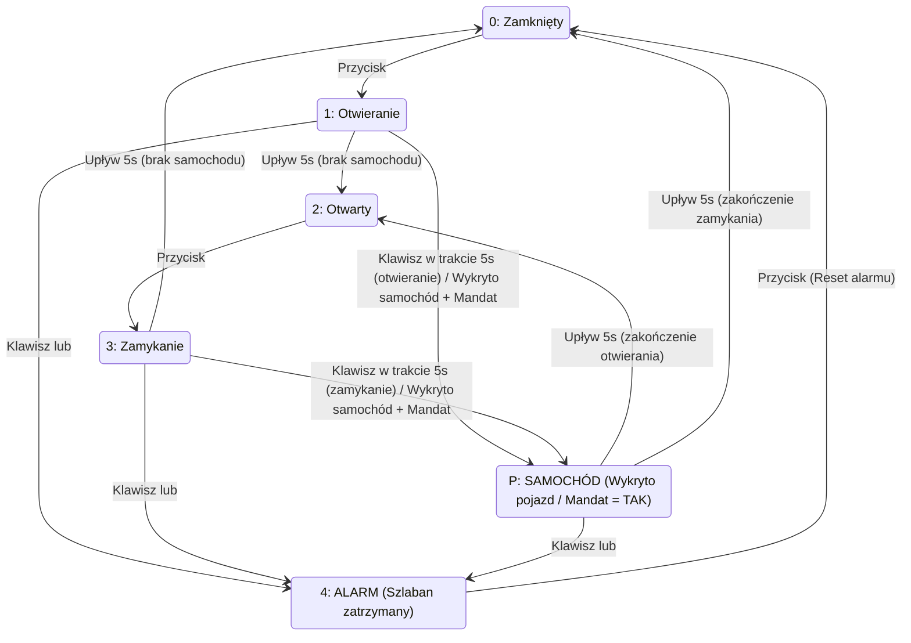

# Symulator Szlabanu (C++)

Prosta aplikacja konsolowa symulująca działanie automatycznego szlabanu oparta na maszynie stanów.

## Funkcjonalności
* **Płynny ruch (5s):** Otwieranie i zamykanie szlabanu trwa 5 sekund z możliwością przerwania w czasie rzeczywistym.
* **System alarmowy:** Naciśnięcie przycisku w trakcie ruchu szlabanu lub wywołanie alarmu natychmiast zatrzymuje mechanizm.
* **Detekcja pojazdów:** Wykrycie auta podczas podnoszenia lub opuszczania zapory skutkuje wystawieniem mandatu.

## Sterowanie
* `1` – Otwórz / Zamknij szlaban (gdy jest w ruchu: wywołuje **ALARM**)
* `3` – Wymuś **ALARM** podczas ruchu
* `4` – Symuluj wykrycie pojazdu (w ruchu = **mandat**)
* `5` – Reset alarmu (przywraca stan *zamknięty*)
* `0` – Wyjście z programu

## Wymagania i kompilacja
Program korzysta z biblioteki `<conio.h>`, dlatego przeznaczony jest dla systemu **Windows**.

