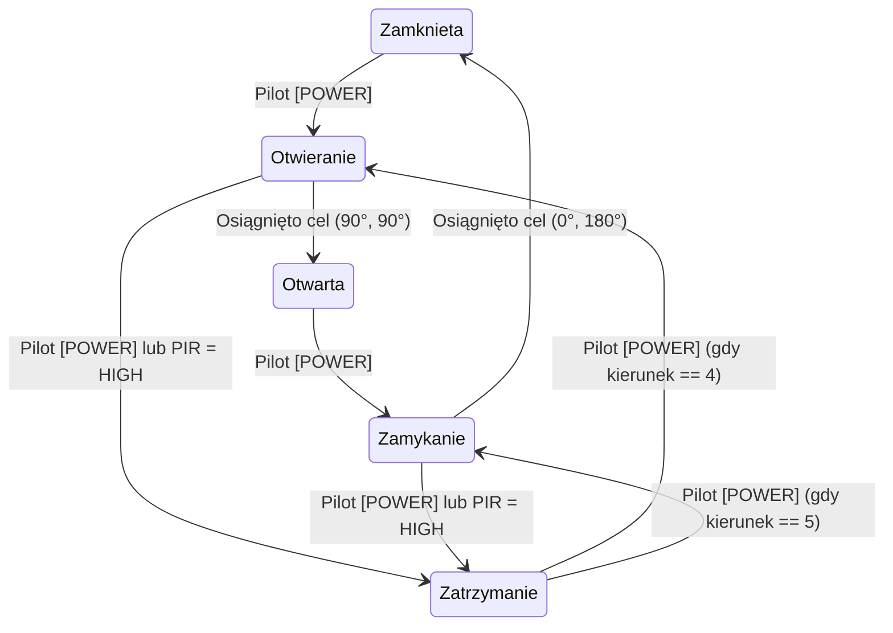

# Automatyczna Brama Dwuskrzydłowa (Arduino)

Projekt sterownika bramy dwuskrzydłowej opartego na mikrokontrolerze **Arduino**. System umożliwia płynne otwieranie i zamykanie skrzydeł za pomocą pilota na podczerwień (IR) oraz zapewnia podstawową ochronę przed przytrzaśnięciem dzięki czujnikowi ruchu (PIR).

## Funkcje projektu

* **Płynny ruch skrzydeł:** Wykorzystanie nieblokującego pomiaru czasu (`millis()`) pozwala na jednoczesny, płynny ruch dwóch serwomechanizmów bez zatrzymywania pracy programu.
* **Sterowanie pilotem IR:** Obsługa przycisku `POWER` w trybie *Krok-po-Kroku* (Otwórz $\rightarrow$ Stop $\rightarrow$ Zamknij $\rightarrow$ Stop).
* **Zabezpieczenie PIR:** Wykrycie ruchu podczas pracy bramy natychmiast ją zatrzymuje i przygotowuje do ruchu w przeciwnym kierunku.
* **Sygnalizacja świetlna:** Dioda LED informuje o aktualnej pracy napędów (świeci tylko podczas ruchu bramy).
* **Filtracja sygnału:** Ignorowanie powtórzeń sygnału przy przytrzymaniu przycisku pilota oraz programowy *debouncing* (300 ms).

---

## Schemat podłączenia (Pinout)

| Komponent | Pin Arduino | Opis funkcji |
| :--- | :---: | :--- |
| **Serwo 1** (Lewe skrzydło) | `D3` (PWM) | Zakres ruchu: `0°` (zamknięta) – `90°` (otwarta) |
| **Serwo 2** (Prawe skrzydło) | `D5` (PWM) | Zakres ruchu: `180°` (zamknięta) – `90°` (otwarta) |
| **Czujnik ruchu PIR** | `D4` | Wyjście cyfrowe (`HIGH` = wykryto ruch/przeszkodę) |
| **Odbiornik podczerwieni IR** | `D10` | Odbiór komend z pilota |
| **Dioda LED (sygnalizacyjna)** | `D12` | Świeci podczas ruchu bramy (`ruch == true`) |

> **Uwaga dotycząca zasilania:** Serwomechanizmy (szczególnie dwa pracujące jednocześnie) potrafią pobierać duży prąd. Zaleca się zasilanie ich z zewnętrznego źródła 5V (ze wspólną masą `GND` z Arduino), aby uniknąć resetowania się mikrokontrolera.

---

## Wymagane biblioteki

Przed kompilacją kodu upewnij się, że w Arduino IDE masz zainstalowane następujące biblioteki:

1. **`Servo`** (wbudowana w Arduino IDE)
2. **`IRremote`** (autor: *shirriff / ArminJo*, wersja 4.x lub nowsza)

---

## Logika działania (Maszyna Stanów)

Program opiera się na maszynie stanów przechowującej aktualny status bramy w zmiennej `stan`:

* **`STAN 0` (Zamknięta):** Brama w pozycji spoczynkowej (`0°` / `180°`).
* **`STAN 1` (Otwarta):** Brama całkowicie otwarta (`90°` / `90°`).
* **`STAN 4` (Otwieranie):** Skrzydła poruszają się w stronę pozycji otwartej.
* **`STAN 5` (Zamykanie):** Skrzydła poruszają się w stronę pozycji zamkniętej.
* **`STAN 6` (Zatrzymanie / Uchylenie):** Brama zatrzymana w trakcie ruchu. Zmienna `kierunek` zostaje odwrócona, dzięki czemu kolejne naciśnięcie pilota wycofa skrzydła.



---

## Konfiguracja

W górnej części pliku `.ino` można łatwo dostosować parametry pracy układu:

```cpp
#define IR_PIN 10     // Pin odbiornika IR
#define POWER 0x00    // Kod heksadecymalny przycisku na pilocie
#define LED 12        // Pin diody sygnalizacyjnej
#define PIR_PIN 4     // Pin czujnika ruchu
```

* **Prędkość ruchu:** Regulowana w funkcji `sterowanieSerwami()` wartością `15` (oznacza przesunięcie o 1 stopień co 15 ms). Zwiększenie tej wartości spowolni bramę.
* **Kąt otwarcia:** Domyślnie ustawiony na `90°` dla obu skrzydeł (`cel1 = 90`, `cel2 = 90`).
